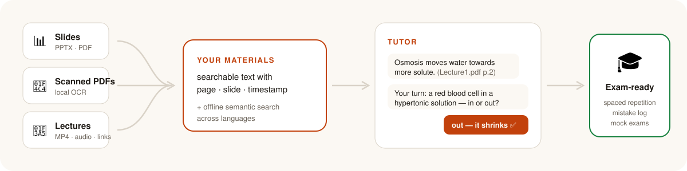
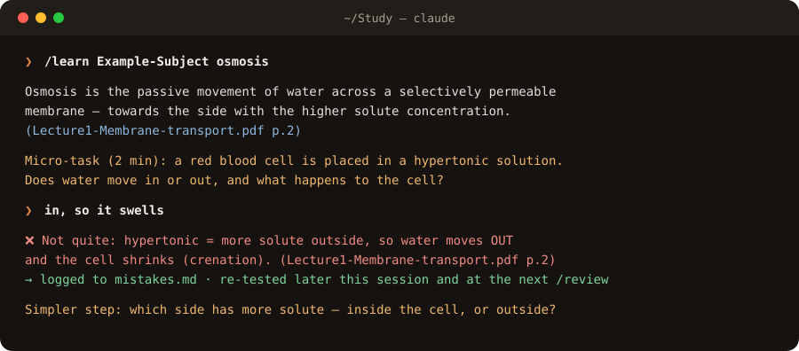
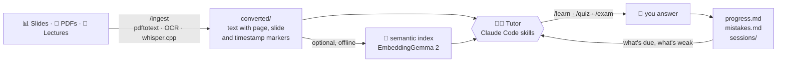

<h1 align="center">Claude Study Agent</h1>

<p align="center">
  <b>An open-source AI study tutor that learns from your own lecture PDFs, slides and recordings.</b><br>
  It teaches topic by topic with citations, quizzes you with spaced repetition,<br>
  and builds mock exams in your real exam format — all from a folder on your computer, no API key.<br>
  <sub>A local-first, open-source alternative to NotebookLM, ChatGPT and Anki for exam revision.</sub>
</p>

<p align="center">
  <a href="LICENSE"></a>
  <a href="https://claude.com/claude-code"></a>
  
  
  
  <a href="CONTRIBUTING.md"></a>
</p>

<p align="center">
  <a href="https://dymchenkko.github.io/claude-study-agent/">Website</a> ·
  <a href="#-quick-start">Quick start</a> ·
  <a href="#-what-it-does">Features</a> ·
  <a href="#-commands">Commands</a> ·
  <a href="#%EF%B8%8F-how-it-works">How it works</a> ·
  <a href="#-how-is-it-different">Vs NotebookLM / Anki</a> ·
  <a href="#-faq">FAQ</a>
</p>

<p align="center">
  <picture>
    <source media="(prefers-color-scheme: dark)" srcset="docs/assets/banner-dark.svg">
    
  </picture>
</p>

## ✨ What it does

| | |
|---|---|
| 📚 **Teaches from your materials** <br> Every explanation cites your own files, like `(Lecture3.pdf p.12)` or `(Lecture5.mp4 [00:14:30])`. No answers from thin air. | 🧠 **Remembers what you forgot** <br> Spaced repetition per topic (1 → 3 → 7 → 16 → 35 days) and a log of every mistake, re-tested until it's fixed. |
| ✍️ **Tutors, doesn't lecture** <br> One idea at a time (≤ 150 words), then a 2–5 minute task. Hints before answers, honest grading ✅ ⚠️ ❌. | 📝 **Mock exams in your format** <br> Quizzes and full mock exams that match your course's real exam, with a weak-spot report and revision plan. |
| 🎥 **Transcribes lectures locally** <br> Video and audio → timestamped text with whisper.cpp, on your machine. Paste a lecture link and it downloads it. | 🔎 **Finds things by meaning** <br> Optional offline semantic search: a question in Polish finds the English slide. Scanned PDFs are read with OCR. |

## 🎓 Who is this for

University and college students who learn from **their own course materials** and want a tutor grounded in those files rather than the open web — especially anyone revising for exams, taking several courses at once, or working with lecture recordings and scanned notes. If you have slides, PDFs and recordings but no time to turn them into flashcards, this builds the study loop for you.

## 📸 Example session

<p align="center">
  
  <br><sub>A <code>/learn</code> session on the included demo course: explanation with a citation, a micro-task, honest grading, and the mistake logged for review.</sub>
</p>

## 🚀 Quick start

```bash
git clone https://github.com/dymchenkko/claude-study-agent.git ~/Study   # the skills expect this path
cd ~/Study && claude                                                     # then type /setup
```

**`/setup`** checks your machine, tells you what is missing, picks the right search mode for your hardware and creates your first subject. Then:

1. Drop files into `<Subject>/materials/` (slides, PDFs, videos, notes).
2. Type **`/ingest <Subject>`**. It converts everything and builds a topic map.
3. Type **`/today`** every day. That's it.

> **Try it first with no files of your own:** `/learn Example-Subject osmosis` uses the included demo course.

## 🧭 Commands

| Command | What it does |
|---|---|
| `/today` | **Start here.** A 15-minute session: due reviews → next topic with micro-tasks → one exam-style question |
| `/learn <topic>` | Tutor one topic step by step from your own materials |
| `/review` | Spaced-repetition recall of everything that is due, across all subjects |
| `/quiz <subject> weak 10` | Multiple-choice and practice questions. Add `html` for a clickable, self-grading quiz |
| `/exam <subject>` | A full mock exam in your exam format, graded, with a weak-spot report |
| `/ingest <subject>` | Convert new files (or a lecture video URL) to searchable text and update the topic map |
| `/status` | Dashboard: progress per subject, reviews due, days to each exam |
| `/setup` | First run or new computer: check the machine, install what's missing, create a subject |

Or just talk to it: *"explain the Krebs cycle using lecture 4"*, *"I have 10 minutes"*, *"my exam is in 5 days"*.

## ⚙️ How it works



Everything the tutor knows about you is plain Markdown that you can read and edit. Your original files are never changed.

<details>
<summary><b>Folder layout</b></summary>

```text
~/Study/
  CLAUDE.md               ← the tutor's rules (edit freely)
  .claude/skills/         ← the commands above
  .tools/study            ← helper: convert, search, doctor, setup
  .tools/semantic.py      ← optional local semantic search
  .tools/ocr.swift        ← OCR for scanned PDFs (macOS, Apple Vision)
  _template/              ← blank subject skeleton
  <Subject>/
    CLAUDE.md             ← course facts: exam date, format, lecturer emphasis
    syllabus.md           ← topic map with sources
    progress.md           ← level and next review date per topic
    mistakes.md           ← every wrong answer and the misconception behind it
    materials/            ← your originals (never modified)
    converted/            ← searchable text with page / slide / [timestamp] markers
    exams/                ← generated quizzes and mock exams
    sessions/             ← one short log per study session
```
</details>

## 💻 Requirements

**Minimum:** [Claude Code](https://claude.com/claude-code) with a Claude Pro or Max plan, macOS or Linux (Windows: WSL), Python 3 (the built-in one works; semantic search needs 3.10+, and `/setup` offers to install it). Run `./.tools/study doctor` to see exactly what your machine has and what is missing.

<details>
<summary><b>Tools per file type</b></summary>

Each tool is only needed for its file type:

```bash
brew install poppler ffmpeg yt-dlp whisper-cpp    # PDF, video/audio, lecture links, transcription
pip install markitdown                            # PPTX / DOCX / XLSX
```

- **Linux:** `apt install poppler-utils ffmpeg`, `pip install yt-dlp`, and build whisper.cpp.
- **Diagrams (UML, ER…), only if a subject needs them:** `brew install --cask drawio`, or the VS Code "Draw.io Integration" extension, or nothing (the browser). The tutor asks once, when a subject first needs a diagram. `study draw <Subject> <name>` opens `<Subject>/diagrams/<name>.drawio`: you draw and save, and the tutor reads the file back and grades it.
- **OCR for scanned PDFs:** on macOS nothing to install beyond `xcode-select --install`. On Linux: `apt install tesseract-ocr` plus a language pack (e.g. `tesseract-ocr-pol`), and set `STUDY_OCR_LANGS=pol+eng`.
- **Whisper model** for transcription (≈575 MB). Skip it if you only have slides and PDFs:

```bash
mkdir -p ~/Study/.tools/models
curl -L -o ~/Study/.tools/models/ggml-large-v3-turbo-q5_0.bin \
  https://huggingface.co/ggerganov/whisper.cpp/resolve/main/ggml-large-v3-turbo-q5_0.bin
```
</details>

<details>
<summary><b>Optional semantic search: which mode fits your machine</b></summary>

Plain search only finds the exact words you type. Semantic search compares *meaning*: "how do I simplify a logic function" finds the Karnaugh-map slides. It uses [EmbeddingGemma 2](https://huggingface.co/google/embeddinggemma-2) (Google, Apache 2.0), text-only, run by [llama.cpp](https://github.com/ggml-org/llama.cpp) on your own machine. No Python packages and no GPU needed. Without it everything still works; the tutor just uses exact-word search.

| | Minimum |
|---|---|
| Hardware | any Mac, or Linux (x64 / arm64) |
| RAM | 4 GB (uses ~0.6 GB while it runs, nothing between searches) |
| Free disk | ~1 GB (it takes ~330 MB: llama.cpp ~30 MB + model 310 MB) |
| Python | 3.10+ (standard library only; `/setup` installs it if yours is older) |
| Network | once, to download llama.cpp and the model |

| Your machine | Mode | Indexing new files | Each search |
|---|---|---|---|
| Mac with Apple Silicon (M1–M4) | `auto` | ~0.03 s per passage (Apple GPU) | ~1.5 s |
| Any other Mac or Linux, 4 GB+ RAM | `cpu` | ~0.1 s per passage (a lecture ≈ 10 s, once) | ~1.5 s |
| < 4 GB RAM, < 1 GB free disk, or "keep it light" | `off` | – | exact-word search only |

Measured on an M2 Pro with a real 24-file course (432 passages). Each search starts llama.cpp, embeds your one question (~0.02 s) and stops it again, so it holds no memory while you study. Downloads are pinned and checked by SHA-256.

**When does the local model run?**
- **`/setup`:** downloads llama.cpp and the model once (~330 MB) and indexes existing subjects.
- **`/ingest`:** embeds only new or changed files.
- **Search:** the tutor calls `study search` in `/learn`, `/quiz`, `/exam`, `/review` and when you ask about a topic. It embeds your one question and returns the best passages with citations.
- **Never:** for exact terms or formulas (those use exact-word search), for transcription (whisper.cpp), or for the teaching itself (Claude).

**Upgrading from the PyTorch version:** run `study setup` once. Old indexes are rebuilt automatically on the first search, and `.tools/.venv` (~1 GB) plus the old model in `~/.cache/huggingface` (~1.5 GB) can be deleted.

`study setup --mode auto|cpu|off` saves the choice in `.tools/config.json`. To override once: `STUDY_DEVICE=cpu ./.tools/study search …`.
</details>

<details>
<summary><b>Setup by hand, without Claude</b></summary>

```bash
./.tools/study doctor                      # what this machine has, and the recommended mode
./.tools/study setup                       # install semantic search (or --mode auto|cpu|off)
./.tools/study new "Biology"
./.tools/study ingest "Biology"            # or: --url <video-link> for a recorded lecture
./.tools/study draw "Biology" cell-cycle     # open a diagram in draw.io (--show prints its contents)
```

Optional: `alias study=~/Study/.tools/study`.
</details>

## 🆚 How is it different?

| | Chatbot / NotebookLM | Flashcard app (e.g. Anki) | **Claude Study Agent** |
|---|:---:|:---:|:---:|
| Answers from *your* course materials, with page citations | ✗ | ✗ | ✅ |
| Creates the questions for you | ✅ | ✗ (you write cards) | ✅ |
| Spaced repetition schedule | ✗ | ✅ | ✅ |
| Remembers *why* you got something wrong | ✗ | ✗ | ✅ |
| Mock exams in your real exam format | ✗ | ✗ | ✅ |
| Transcribes and searches lecture recordings | ✗ | ✗ | ✅ (locally) |

## ❓ FAQ

<details>
<summary><b>What is Claude Study Agent?</b></summary>

An open-source AI tutor for university courses, built as a set of [Claude Code](https://claude.com/claude-code) skills. You put your lecture slides, PDFs and recordings in a folder; it converts them to searchable text, teaches you topic by topic with short tasks, schedules reviews with spaced repetition, logs your mistakes and builds mock exams in your course's exam format.
</details>

<details>
<summary><b>How is it different from NotebookLM, ChatGPT or Anki?</b></summary>

Unlike a general chatbot or NotebookLM, it is a full study loop, not just Q&A over your documents: it decides what to teach next, tests you with one task at a time, grades honestly and schedules spaced-repetition reviews. Unlike a flashcard app like Anki, it writes the questions for you and remembers *why* you got something wrong. And every answer is cited from your own files, with local transcription and cross-language search of lecture recordings. See the [comparison table](#-how-is-it-different) above.
</details>

<details>
<summary><b>Do I need an API key? What does it cost?</b></summary>

No API key. It runs on your existing Claude Pro or Max subscription through Claude Code, and sessions count towards your normal plan limits. Every other part (conversion, OCR, transcription, semantic search) is free and open-source and runs on your machine.
</details>

<details>
<summary><b>Do my lecture files get uploaded anywhere?</b></summary>

Your files stay on your computer. Conversion, OCR, transcription and the search index all run locally. When the tutor teaches, the passages it reads are sent to Claude as part of the conversation, like any Claude Code session.
</details>

<details>
<summary><b>Which file types and languages does it support?</b></summary>

PDF (including scanned PDFs via OCR), PPTX, DOCX, XLSX, Markdown and text, plus video and audio (MP4, MOV, MKV, WEBM, M4A, MP3, WAV) and lecture links via yt-dlp. Materials can be in any language Claude reads; Whisper detects the spoken language, macOS OCR reads 30+ languages (including Japanese, Chinese, Korean and Polish), and semantic search works across languages.
</details>

<details>
<summary><b>Does it work on Windows?</b></summary>

Yes, through WSL (Windows Subsystem for Linux). Native Windows is not supported.
</details>

<details>
<summary><b>Can I use it for several courses at once?</b></summary>

Yes. Each course is its own folder with its own exam date, topic map, progress and mistakes. `/review` and `/status` cover all of them.
</details>

<details>
<summary><b>How does the spaced repetition work?</b></summary>

Each topic has a level and a review interval on the ladder 1 → 3 → 7 → 16 → 35 days. A correct recall moves it one step up; a miss sends it back to 1 day. `/today` and `/review` start with whatever is due.
</details>

## 💡 Tips

- Use `/ingest` inside Claude rather than the plain `study ingest`: it also updates the topic map.
- Long lecture transcripts use more of your plan. The tutor searches first and reads only the relevant parts.
- New computer? Clone, copy your subject folders over, and run `/setup`. The search index is rebuilt automatically.
- Your own subjects are excluded by `.gitignore`, so your materials and progress stay private even if you push your copy.

## 🤝 Contributing

Ideas, issues and pull requests are welcome. See [CONTRIBUTING.md](CONTRIBUTING.md). The commands are plain Markdown skills in `.claude/skills/`, so a new command is a good first contribution.

## 📄 License

MIT. See [LICENSE](LICENSE).

<p align="center"><sub>If this helped you study, a ⭐ helps other students find it.</sub></p>
